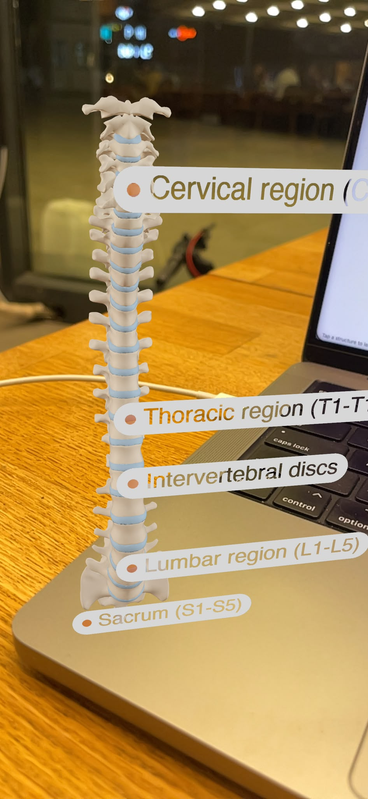
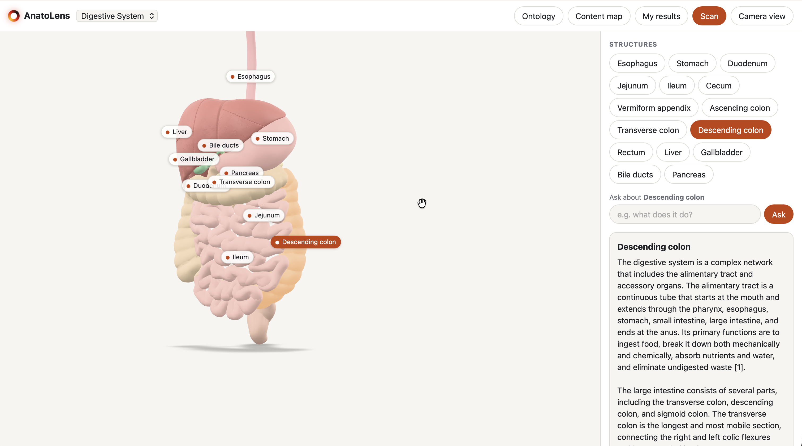
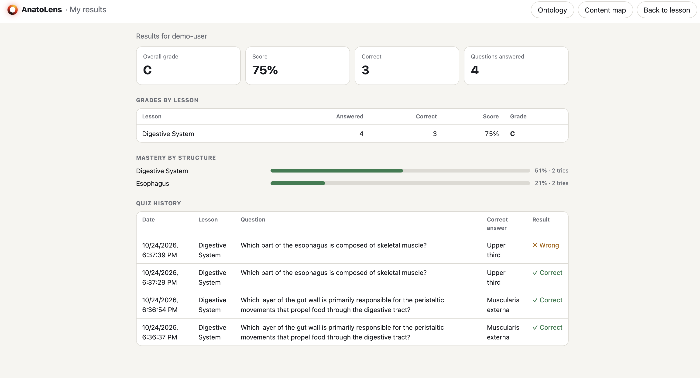
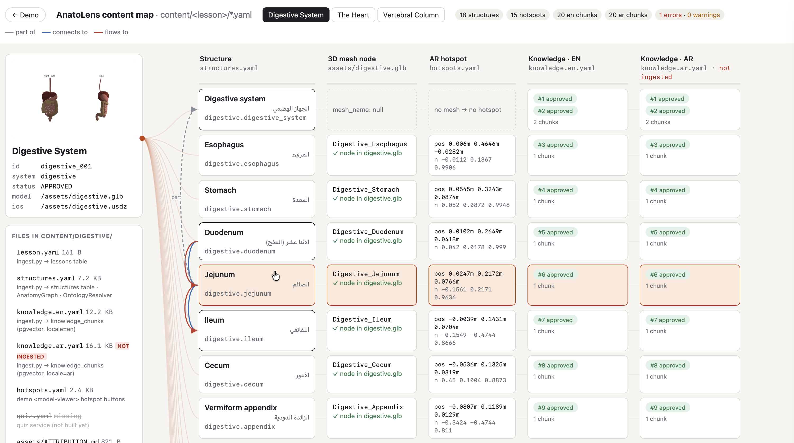
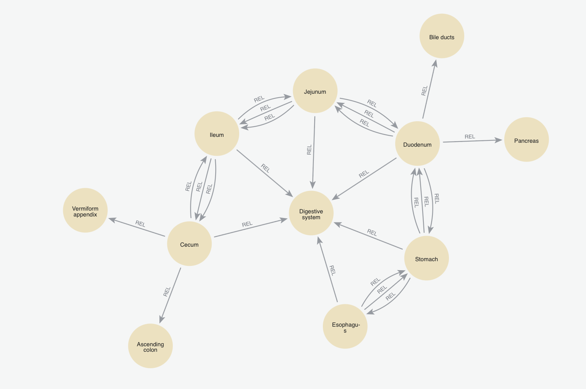

# AnatoLens

AnatoLens turns an anatomy textbook into something you can walk around. Point your phone at a page, and the app works out which lesson it is, puts a 3D model of that system on your desk, and lets you tap any structure to read about it or ask a question. Answers come in English or Arabic and are built only from reviewed lesson content, so the tutor doesn't make things up or wander off topic.

Lessons available today: the vertebral column, the heart and the digestive system.

> AnatoLens is for learning anatomy. It is not a tool for diagnosis or health advice.

<p align="center">
  
</p>

## What you can do with it

### Scan a page, open the lesson

Hit **Scan** and point the camera at a textbook page. Recognition runs in layers:

1. A perceptual hash catches an exact or near-exact match of a known page.
2. An image embedding (ViT) searches the stored pages by similarity.
3. A CLIP check compares the photo against each lesson's subject ("the human heart", ...).

If the result is confident the lesson opens straight away. If it's close, the app asks you to confirm. If nothing matches well enough, it asks you to rescan instead of guessing. The thresholds are all in `.env` (`RECOGNITION_*`).

### Explore the model in 3D and AR

Each lesson comes with a GLB model (and USDZ for iOS) with hotspots pinned to the actual meshes. Drag to rotate, pinch to zoom, tap a label or pick a structure from the list on the right.

**Camera view** places the model in your room. It uses WebXR where the browser supports it, falls back to Quick Look on iOS and Scene Viewer on Android, and on anything else it draws the model over the live camera feed.



### Ask the tutor

Select a structure and ask about it: "what does it do?", "how does it connect to the duodenum?", "ما وظيفته؟". Here's what happens behind the answer:

- **Ontology resolver.** Whatever you typed (English, Arabic, aliases, short forms like "lmbr") is mapped to a structure the lesson actually has. Unknown structures are refused rather than invented.
- **Hybrid retrieval.** Dense search (pgvector) and BM25 run together over approved knowledge only.
- **GraphRAG.** The anatomy graph (`part_of`, `connects_to`, `flows_to`, `supplies`) pulls in neighbouring structures, so an answer about the jejunum can mention the duodenum and ileum.
- **Guardrails.** Off-topic questions are redirected back to the lesson. Every answer is checked by a grounding judge against the retrieved context before you see it. Answers carry citations like `[1]`.
- **Model routing.** Simple questions go to a small, cheap model. "Why / compare / mechanism / clinical" questions go to a stronger one, with a fallback if the call fails.
- **Semantic cache.** Grounded answers are cached in Redis by meaning, per structure and language, so repeated questions come back instantly.
- **Streaming.** Responses stream over SSE.

The tutor runs as a LangGraph flow (guard → recognize → explain). It can also run as a tool-calling agent over an MCP server that exposes `search_knowledge`, `get_structure`, `graph_neighbors` and `get_quiz_bank` (`TUTOR_MODE`, `KNOWLEDGE_SOURCE`).

### Quizzes that adapt to you

Students get multiple-choice questions written from approved content only. A contextual bandit picks the next structure and difficulty (easy / medium / hard) based on how you've been doing, so time goes to the parts you're weakest on rather than the ones you already know.

### Track progress

**My results** shows your overall grade, score per lesson, mastery for each structure and the full quiz history with the correct answers. Teachers can open the same page for any student (`results.html?user=<id>`).



### See how a lesson is put together

**Content map** lays out a whole lesson pack in one screen: every structure next to its mesh node in the GLB, its AR hotspot position, and its English and Arabic knowledge chunks with their review status. The lines on the left show the graph relations. Missing meshes, unanchored hotspots or files that haven't been ingested are flagged at the top, so broken content is caught before students see it.



**Ontology** draws the structure graph for each lesson.

### Anatomy graph in Neo4j

The relations live in a graph store. RDFLib works out of the box, and setting `GRAPH_BACKEND=neo4j` switches to Neo4j. Neo4j lets you browse the graph at http://localhost:7474 (user `neo4j`, password `anatolens`):

```cypher
MATCH (a)-[r]->(b) RETURN a, r, b LIMIT 100;
```



### Authoring and medical review

Staff use the admin panel (`/review.html`) to build lessons:

- **Drafting.** An editor picks a structure and the model writes a draft explanation for it.
- **Diagram analysis.** An editor uploads a labelled diagram. The app segments the labelled regions, reads which structures are shown, and proposes relations that are missing from the graph (for example, "duodenum `connects_to` pancreas"). It can also build a 3D mesh from the diagram.
- **Review.** Nothing reaches students until a medical reviewer approves it. Drafts pause at review on a LangGraph `interrupt()` backed by a Postgres checkpointer, so a pending review survives a restart. Approved drafts are written to the knowledge base as `APPROVED`. Rejected ones go back to `CONTENT_REVIEW`. Proposed relations and generated meshes go through the same approve / reject step.
- **Lifecycle.** Lessons move through explicit status transitions, and every action is role-guarded.

### Accounts and roles

Sign-in uses JWT, with access and refresh tokens. Anyone can register as a student. Other roles are created by an admin.

| Account                                   | Role             | Can do                                              |
| ----------------------------------------- | ---------------- | --------------------------------------------------- |
| `admin@anatolens.dev`                     | SUPER_ADMIN      | everything, creates staff accounts                  |
| `editor@anatolens.dev`                    | CONTENT_EDITOR   | creates lessons, starts drafts, analyses diagrams   |
| `reviewer@anatolens.dev`                  | MEDICAL_REVIEWER | approves or sends back drafts, relations and meshes |
| `teacher@anatolens.dev`                   | TEACHER          | lessons, quizzes, any student's results             |
| `amira@` / `omar@` / `lina@anatolens.dev` | STUDENT          | lessons, quizzes, own results                       |

These are created by `python -m app.seed_users`. The login screen lists them for one-click sign-in.

### Quality and observability

- An evaluation suite in `backend/eval/` covers RAG answers, recognition (blurred, dark, cropped, rotated and low-res pages, plus negatives), guardrails with a red-team set, and the grounding judge. Results are logged to MLflow.
- `python -m eval.gate` fails the build if any metric drops below its threshold. CI runs lint, unit tests, integration tests and the gate on every push.
- LangSmith / OpenTelemetry tracing and per-request token cost tracking.

## TODO Coming next

- **Skull**: cranial and facial bones, mandible, sutures
- **Brain**: cerebral lobes, cerebellum, brainstem, thalamus, ventricles
- **Respiratory system**: larynx, trachea, bronchi, lungs and lobes, diaphragm
- **Urinary system**: kidneys, ureters, bladder, urethra
- **Upper limb**: clavicle, scapula, humerus, radius, ulna, hand bones

## Project layout

```
backend/   FastAPI app: REST, GraphQL (strawberry), SSE tutor, admin API
content/   one folder per lesson: lesson.yaml, structures.yaml, knowledge.{en,ar}.yaml,
           hotspots.yaml, GLB/USDZ models; _tools/ builds models and hotspots
demo/      web app (Vite + TypeScript + <model-viewer>)
infra/     docker compose: Postgres + pgvector, Redis, MLflow, Neo4j
```

## Running it

Start the services:

```bash
docker compose -f infra/docker-compose.yml up -d
```

Backend:

```bash
cd backend
python -m venv .venv && source .venv/bin/activate   # .venv\Scripts\activate on Windows
pip install -e . -r requirements.txt
cp .env.example .env    # set OPENAI_API_KEY
alembic upgrade head
python -m app.seed_users
python -c "from app.db.session import SessionLocal; from app.content.ingest import ingest_pack; db=SessionLocal(); [print(ingest_pack(f'../content/{p}', db)) for p in ('spine', 'heart', 'digestive')]"
uvicorn app.main:app --reload
```

Web app:

```bash
cd demo
npm install
npm run dev
```

The web app talks to `http://localhost:8000` by default (override with `VITE_API`) and serves the models directly from `content/`.

## API

|                                                                    |                                                                              |
| ------------------------------------------------------------------ | ---------------------------------------------------------------------------- |
| `POST /api/v1/recognition/page`                                    | upload a page photo                                                          |
| `GET /api/v1/lessons`, `/lessons/{id}`, `/lessons/{id}/structures` | lessons and structures                                                       |
| `POST /api/v1/structures/{id}/explain`                             | explanation of one structure                                                 |
| `POST /api/v1/tutor/ask`                                           | tutor question (SSE)                                                         |
| `POST /api/v1/quiz/next`, `/quiz/submit`                           | adaptive quiz                                                                |
| `GET /api/v1/progress/{user_id}`, `/history/{user_id}`             | mastery and quiz history                                                     |
| `POST /api/v1/auth/register`, `/login`, `/refresh`, `GET /auth/me` | auth                                                                         |
| `/api/v1/admin/...`                                                | lessons, transitions, drafting, reviews, diagram analysis, proposals, meshes |
| `/graphql`                                                         | read lessons and structures                                                  |

## Tests

```bash
cd backend && pytest
cd demo && npm test     # Playwright
```

Some backend tests need the Postgres container running. Tests that call a language model need `OPENAI_API_KEY`. The API and GraphQL tests run without either.

## Credits

3D models are derived from BodyParts3D (CC BY 4.0). Details are in `content/*/assets/ATTRIBUTION.md`.

> **Note:** AnatoLens is built for learning anatomy only. It does not diagnose conditions or give health or medical advice, and nothing it shows should be used to make decisions about your health. If you have a health concern, talk to a qualified doctor or healthcare professional.
